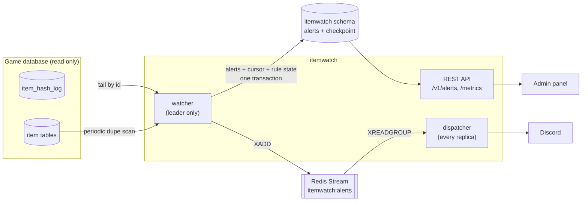

# itemwatch

[](https://github.com/victorcamposr/itemwatch/actions/workflows/ci.yml)

Real-time detection of item duplication and abnormal item creation for an online game server, written in Go.

In an MMORPG, one duplication bug can flood the economy in hours: the copied items get traded, sold and mixed into
legitimate stock before anyone notices. itemwatch tails the server's item ledger, flags what looks wrong, and announces
each incident once to the staff, on Discord and through a REST API used by the team's admin panel. It also keeps an
eye on the game itself with synthetic checks, and says so when the server or its own database stops working.

I built it for an [Open Tibia](https://github.com/opentibiabr/canary) server I develop. It runs next to the game in the
same Docker Compose stack.

## How the game side works

Every item a player can pick up is stamped with a unique 16-hex tracking hash when it is created, and the game server
appends one row per lifecycle event to a ledger table (`item_hash_log`): `birth` (with its origin, such as
`loot:Dragon`, `quest:Annihilator` or `gm:<name> <command>`), `split`, `clone`, `market-in`, `unhashed` and so on. The
item tables (inventory, depot, inbox, market offers) carry the hash too.

itemwatch only reads those tables. It never writes to the game database.

## What it detects

| Rule | Signal | Severity |
|---|---|---|
| `dupe` | The same hash held in two places at once (two characters, or inventory and depot). Confirmed only after it survives every scan for longer than the server's save interval, because a freshly traded item briefly shows under both owners until the old one saves. | critical |
| `burst` | One player receiving too many items from one origin in a sliding window, with per-origin limits such as `quest:=3/24h` or `loot:=1500/10m`. Catches a quest reward paid twice or a script stuck in a loop. | warning |
| `spike` | An origin creating far more items than it normally does, across all players. Learns each origin's rate with an exponentially weighted mean and variance and alerts above `mean + k·σ`, once at least three distinct players share the bucket (one hunter clearing a pack is the `burst` rule's business). Items with no player at all always count. Catches many accounts exploiting the same bug at once, which per-player limits miss. | warning |
| `unhashed` | A tracked item that reached a save without a hash: some code path skipped the item factory. | warning |
| `repeat` | An origin that should give a character items a single time (a starter kit, listed in `ITEMWATCH_ONCE_ORIGINS`) giving the same player items again after the first delivery window. These origins leave the `spike` rule: a wave of new characters is not an exploit. | warning |
| `staff` | Items created by staff commands, grouped per command and hour, for the record. | info |
| `ledger` | The ledger ids went back below the cursor (the table was rebuilt or emptied). The watcher resumes from the last row created before its checkpoint, so new rows are not skipped. | warning |
| `probe` | A health check that kept failing past its grace period (see [Health checks](#health-checks)). | critical |

## Architecture



### Delivery guarantees

The interesting part is not the detection; it is making sure each incident is reported once, even when processes crash
at the worst possible moment.

- **Detection is exactly-once.** The watcher reads the ledger by id from a cursor. The alerts produced by a batch, the
  new cursor *and the serialized state of every rule* are committed in one MariaDB transaction. After a crash the service
  resumes from the checkpoint with the rules exactly as they were, so it neither skips rows nor counts them twice. If a
  commit fails, the in-memory rule state is rewound to the checkpoint before retrying.
- **Incidents are deduplicated in the database.** Each finding carries a dedup key (rule + what makes it the same
  incident, hashed). An upsert folds repeats into one alert and counts occurrences. A resolved incident that happens again
  is reopened with a new *generation*, which is announced again.
- **Publishing survives the dual write.** The alert row is the source of truth; the stream only carries "announce this".
  Publishing happens after the commit, so a crash in between leaves the alert marked unpublished, and a recovery loop
  publishes it again.
- **Consumers are idempotent.** Dispatchers read through a Redis consumer group. Before posting, a dispatcher takes an
  idempotency key `(channel, alert id, generation)` with `SET NX`; it becomes `done` after a successful post. A message
  published twice, or redelivered after a crash, is acknowledged without posting again.
- **Failures are retried with backoff, then dead-lettered.** A failed delivery stays in the pending entries list and is
  claimed again with `XCLAIM` once it has been idle for an exponential backoff (15 s, doubling up to 15 min). After eight
  deliveries, or on a permanent error such as a revoked webhook (HTTP 4xx other than 429), the message moves to a
  dead-letter stream.
- **One leader, any number of replicas.** Only the replica holding a MariaDB named lock (`GET_LOCK`) reads the ledger and
  writes the checkpoint. The lock lives with the connection, so if the leader dies a standby takes over within seconds.
  Dispatchers and the API run on every replica.

### Design choices

- **Polling by id instead of binlog CDC.** The ledger is append-only with an auto-increment key and a single writer, so
  `WHERE id > ? ORDER BY id LIMIT n` is cheap, simple to reason about and needs no extra privileges on the database.
  The one way this breaks is a table rebuilt with lower ids: every new row would sit below the cursor, unread, while the
  lag still reads zero. Every 15 s the watcher compares the newest id with the cursor; when it is lower, it moves the
  cursor back to the last row created before the checkpoint and raises a `ledger` alert in the same commit.
- **Bounded memory.** Sliding windows are approximated with 20 sub-buckets per window, so state does not grow with
  traffic, and quiet keys are pruned on every checkpoint.
- **Redis Streams over a database outbox table.** Consumer groups, the pending entries list and `XCLAIM` give retries and
  crash recovery without hand-written bookkeeping, and the stream decouples detection from slow notification channels.
  The price is the dual write described above.
- **Text rendered once.** Alert titles are rendered when the alert is stored (English or Brazilian Portuguese), so the
  API, Discord and the admin panel show the same words.

## Health checks

A process being up says little: a game can hold its port open with the game loop frozen, or look online while its
database refuses every write. These checks exercise the real paths, each one off until configured.

| Check | What it does | Proves |
|---|---|---|
| `ot-status` | Sends the Open Tibia status query over TCP and parses the `<tsqp>` reply, keeping uptime and players online. | the game loop answers, not just the port |
| `http-login` | Signs in through the client's HTTP login with a dedicated account. Success is a `200` with `session` and no `errorCode`. | web service, database and account data work together |
| `db-write` | Upserts a row in `probe_heartbeat`, in itemwatch's own schema. | the database accepts writes, not just reads |

A check that fails is not an incident yet, because a planned restart fails all of them for a while. Only continuous
failure for `ITEMWATCH_PROBE_FAIL_AFTER` raises a `probe` alert, through the same path as the rules: one row per check,
deduplicated, published and delivered with the same guarantees. The first success resolves it with `resolved_by` set to
`probe`, and failing again reopens it with a new generation.

Two cases need more than that:

- **The alert cannot be stored.** A database that refuses writes also refuses the alert saying so. The write is retried
  on the next tick, then the alert goes straight to the notification channels, once, with no database and no Redis in
  the way. Storing keeps being tried, and the row appears when the database is back, without a second announcement. If
  the channels fail too, the failure stays in the error log and in `/v1/status`, and both are retried on every tick.
- **There is no leader.** Checks run on the leader only, but the leader lock lives in the state database, so losing that
  database leaves no leader at all. A replica that cannot reach the database runs the checks too, otherwise the worst
  outage would be the quiet one. With several replicas, each one announces such an outage once.

Point `ITEMWATCH_PROBE_LOGIN_*` at an account made for this, without two-factor authentication. If the login only lets
the current client in by comparing a hash of the published package, mount that file read-only and point
`ITEMWATCH_PROBE_LOGIN_PACKAGE_FILE` at it: its SHA-256 goes along as `clientpackage`. Keep the interval above
the server's `statusTimeout`: inside it the server drops a second query from the same address, and the check fails.

## REST API

All `/v1` routes require `Authorization: Bearer <ITEMWATCH_API_TOKEN>`.

| Method | Path | |
|---|---|---|
| `GET` | `/v1/alerts?status=open&min_severity=warning&rule=dupe&limit=50&before_id=` | newest first, paginated by id |
| `GET` | `/v1/alerts/{id}` | one alert with its details |
| `POST` | `/v1/alerts/{id}/resolve` | body `{"by": "staff name", "note": "..."}`; `409` if not open |
| `POST` | `/v1/alerts/{id}/reopen` | `409` if not resolved |
| `GET` | `/v1/stats` | open alerts per severity and checkpoint position |
| `GET` | `/v1/status` | whether the service itself is healthy: leader, ledger lag, queue and health checks |
| `GET` | `/healthz`, `/readyz` | liveness, and readiness (both databases and Redis) |
| `GET` | `/metrics` | Prometheus |

```json
{
  "id": 7,
  "rule": "dupe",
  "severity": "critical",
  "title": "Item 3f9c0a1e22b4d817 is in 2 places at once",
  "details": {
    "holders": [
      {"place": "inventory", "player_id": 3, "player_name": "Cora"},
      {"place": "depot", "player_id": 4, "player_name": "Dain"}
    ],
    "places": 2,
    "first_seen": "2026-10-15T15:20:00Z"
  },
  "status": "open",
  "occurrences": 1,
  "generation": 0
}
```

`/v1/status` is what to read when something looks wrong, so it answers `200` even when a dependency is down. Every
dependency has two seconds and fails alone: a number it should have provided turns to `-1`.

```json
{
  "version": "1.4.0",
  "started_at": "2026-10-15T11:00:00Z",
  "leader": true,
  "ledger": {"cursor": 90412, "head": 90415, "lag": 3, "last_read_at": "2026-10-15T15:20:01Z"},
  "dupe_scan": {"enabled": true, "last_at": "2026-10-15T15:19:00Z"},
  "queue": {"pending": 0, "dead_letter": 0},
  "probes": [
    {
      "name": "ot-status", "ok": true, "failing_since": null, "last_ok_at": "2026-10-15T15:20:00Z",
      "last_error": "", "ms": 4, "alert": "none", "facts": {"players_online": 12, "uptime_seconds": 6286}
    }
  ]
}
```

| Field | |
|---|---|
| `ledger.cursor` | live on the leader, the saved checkpoint on other replicas; `-1` if that read failed |
| `ledger.head` | `MAX(id)` of the ledger; `-1` if the game database did not answer |
| `ledger.lag` | `head - cursor`, `-1` if either is unknown |
| `ledger.last_read_at` | last successful poll, even if it found no rows; `null` on a replica that never led |
| `dupe_scan.last_at` | last completed scan on this replica; `null` on a replica that never led |
| `queue.pending` | notifications the consumer group has not finished, `0` with no channel configured, `-1` if Redis is down |
| `queue.dead_letter` | entries in the dead-letter stream, `-1` if Redis is down |
| `probes` | checks run by this replica, so usually empty unless `leader` is true |
| `probes[].alert` | `none`, `stored` (normal path), `direct` (announced, row pending) or `undelivered` (nobody heard: only the log and this field know) |

## Metrics

`itemwatch_ledger_rows_processed_total`, `itemwatch_ledger_lag_rows`, `itemwatch_batch_duration_seconds`,
`itemwatch_findings_total{rule,severity}`, `itemwatch_dupe_scan_duration_seconds`, `itemwatch_dupes_tracked`,
`itemwatch_alerts_published_total`, `itemwatch_notifications_total{channel,result}` and `itemwatch_leader`.

## Running it

The demo stack starts MariaDB with a minimal game schema, Redis, itemwatch and `ledgersim`, a simulator that writes
normal loot traffic and injects one anomaly every 90 seconds (a quest reward paid four times, a duplicated item, an
unhashed item, a loot spike):

```sh
docker compose up --build
curl -s -H "Authorization: Bearer demo-token" localhost:8080/v1/alerts | jq
```

Export `DISCORD_WEBHOOK_URL` before `docker compose up` to receive the alerts on a Discord channel too.

### Configuration

Everything is set through environment variables; see [`.env.example`](.env.example) and
[`internal/config`](internal/config/config.go) for the full list.

| Variable | Default | |
|---|---|---|
| `ITEMWATCH_GAME_DSN` | | game database, read only |
| `ITEMWATCH_STATE_DSN` | | itemwatch's own schema; tables are created on boot |
| `ITEMWATCH_REDIS_URL` | `redis://localhost:6379/0` | |
| `ITEMWATCH_API_TOKEN` | | bearer token for `/v1` |
| `ITEMWATCH_DISCORD_WEBHOOK_URL` | | optional |
| `ITEMWATCH_DISCORD_MIN_SEVERITY` | `warning` | |
| `ITEMWATCH_LANG` | `en` | `en` or `pt-BR` |
| `ITEMWATCH_START` | `latest` | with no checkpoint, start at the end of the ledger, or `earliest` to replay it |
| `ITEMWATCH_BURST_LIMITS` | see config | `pattern=max/window`, most specific pattern wins |
| `ITEMWATCH_IGNORE_ORIGINS` | `world,change,bank,stash,market,...` | origins that move value instead of creating it |
| `ITEMWATCH_ONCE_ORIGINS` | empty | origins that give a character items once (`starter:*`): out of `spike`, watched by `repeat` |
| `ITEMWATCH_ONCE_WINDOW` | `10m` | how long one delivery of those origins may take before a new one counts as a repeat |
| `ITEMWATCH_STAFF_RULE` | `true` | `false` turns off the `staff` record, for servers that keep their own log of staff commands |
| `ITEMWATCH_DUPE_CONFIRM_AFTER` | `20m` | keep above the server's save interval |
| `ITEMWATCH_SPIKE_K`, `_ALPHA`, `_MIN_COUNT`, `_MIN_PLAYERS`, `_WARMUP` | `4`, `0.05`, `50`, `3`, `30` | spike detector tuning |
| `ITEMWATCH_PROBE_STATUS_ADDR` | | `host:port` of the status protocol; turns `ot-status` on |
| `ITEMWATCH_PROBE_LOGIN_URL`, `_LOGIN_EMAIL`, `_LOGIN_PASSWORD` | | all three turn `http-login` on |
| `ITEMWATCH_PROBE_LOGIN_PACKAGE_FILE` | | file whose SHA-256 `http-login` sends as `clientpackage` |
| `ITEMWATCH_PROBE_DB_WRITE` | `false` | turns `db-write` on |
| `ITEMWATCH_PROBE_INTERVAL` | `30s` | time between runs |
| `ITEMWATCH_PROBE_FAIL_AFTER` | `5m` | continuous failure before alerting; keep above a planned restart |

The database user needs `SELECT` on the ledger, item and `players` tables of the game schema and full rights on its own
schema.

### Tests

```sh
go test ./...                                   # unit tests
go test -tags integration ./internal/itest/     # real MariaDB and Redis through testcontainers (needs Docker)
```

The integration suite checks the guarantees above against real services: a restart resumes from the checkpoint without
new alerts, a resolved duplicate that is still there reopens with a new generation, a delivery that fails twice is
retried and posted once, a republished message is not posted again, a permanent failure lands in the dead-letter
stream, a standby replica takes the leader lock when the leader stops, and a health check alert goes through open,
resolved and reopened without being announced twice.

## Limits

- Stackable items merged into another stack keep only the receiving stack's hash, so duplicated gold that was merged is
  invisible to the duplicate scan. The `burst` and `spike` rules are the safety net for currency.
- The duplicate scan reads the last saved state of each character. Items stored in houses are serialized in a blob per
  house and are not scanned.
- itemwatch needs the state database to start. If it restarts during a database outage it exits and retries, and until
  then nothing watches: keep an external uptime check on `/healthz`.

## License

[MIT](LICENSE)
