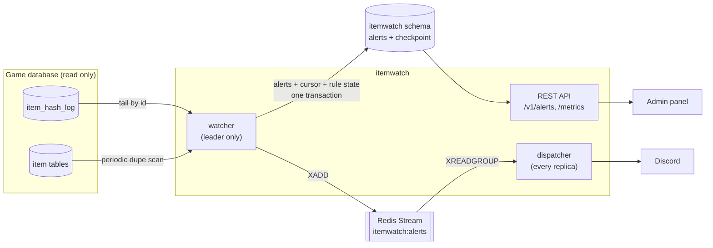

# itemwatch

[](https://github.com/victorcamposr/itemwatch/actions/workflows/ci.yml)

Real-time detection of item duplication and abnormal item creation for an online game server, written in Go.

In an MMORPG, one duplication bug can flood the economy in hours: the copied items get traded, sold and mixed into
legitimate stock before anyone notices. itemwatch tails the server's item ledger, flags what looks wrong, and announces
each incident once to the staff, on Discord and through a REST API used by the team's admin panel.

I built it for an [Open Tibia](https://github.com/opentibiabr/canary) server I develop. It runs next to the game in the
same Docker Compose stack.

## How the game side works

Every item a player can pick up is stamped with a unique 16-hex tracking hash when it is created, and the game server
appends one row per lifecycle event to a ledger table (`item_hash_log`): `birth` (with its origin, such as
`loot:Dragon`, `quest:Annihilator` or `gm:<name> <command>`), `split`, `clone`, `market-in`, `unhashed` and so on. The
item tables (inventory, depot, inbox, market offers) carry the hash too.

itemwatch only reads those tables. It never writes to the game database.

## What it detects

| Rule | Signal | Severity |
|---|---|---|
| `dupe` | The same hash held in two places at once (two characters, or inventory and depot). Confirmed only after it survives every scan for longer than the server's save interval, because a freshly traded item briefly shows under both owners until the old one saves. | critical |
| `burst` | One player receiving too many items from one origin in a sliding window, with per-origin limits such as `quest:=3/24h` or `loot:=1500/10m`. Catches a quest reward paid twice or a script stuck in a loop. | warning |
| `spike` | An origin creating far more items than it normally does, across all players. Learns each origin's rate with an exponentially weighted mean and variance and alerts above `mean + k·σ`. Catches many accounts exploiting the same bug at once, which per-player limits miss. | warning |
| `unhashed` | A tracked item that reached a save without a hash: some code path skipped the item factory. | warning |
| `staff` | Items created by staff commands, grouped per command and hour, for the record. | info |

## Architecture



### Delivery guarantees

The interesting part is not the detection; it is making sure each incident is reported once, even when processes crash
at the worst possible moment.

- **Detection is exactly-once.** The watcher reads the ledger by id from a cursor. The alerts produced by a batch, the
  new cursor *and the serialized state of every rule* are committed in one MariaDB transaction. After a crash the service
  resumes from the checkpoint with the rules exactly as they were, so it neither skips rows nor counts them twice. If a
  commit fails, the in-memory rule state is rewound to the checkpoint before retrying.
- **Incidents are deduplicated in the database.** Each finding carries a dedup key (rule + what makes it the same
  incident, hashed). An upsert folds repeats into one alert and counts occurrences. A resolved incident that happens again
  is reopened with a new *generation*, which is announced again.
- **Publishing survives the dual write.** The alert row is the source of truth; the stream only carries "announce this".
  Publishing happens after the commit, so a crash in between leaves the alert marked unpublished, and a recovery loop
  publishes it again.
- **Consumers are idempotent.** Dispatchers read through a Redis consumer group. Before posting, a dispatcher takes an
  idempotency key `(channel, alert id, generation)` with `SET NX`; it becomes `done` after a successful post. A message
  published twice, or redelivered after a crash, is acknowledged without posting again.
- **Failures are retried with backoff, then dead-lettered.** A failed delivery stays in the pending entries list and is
  claimed again with `XCLAIM` once it has been idle for an exponential backoff (15 s, doubling up to 15 min). After eight
  deliveries, or on a permanent error such as a revoked webhook (HTTP 4xx other than 429), the message moves to a
  dead-letter stream.
- **One leader, any number of replicas.** Only the replica holding a MariaDB named lock (`GET_LOCK`) reads the ledger and
  writes the checkpoint. The lock lives with the connection, so if the leader dies a standby takes over within seconds.
  Dispatchers and the API run on every replica.

### Design choices

- **Polling by id instead of binlog CDC.** The ledger is append-only with an auto-increment key and a single writer, so
  `WHERE id > ? ORDER BY id LIMIT n` is cheap, simple to reason about and needs no extra privileges on the database.
- **Bounded memory.** Sliding windows are approximated with 20 sub-buckets per window, so state does not grow with
  traffic, and quiet keys are pruned on every checkpoint.
- **Redis Streams over a database outbox table.** Consumer groups, the pending entries list and `XCLAIM` give retries and
  crash recovery without hand-written bookkeeping, and the stream decouples detection from slow notification channels.
  The price is the dual write described above.
- **Text rendered once.** Alert titles are rendered when the alert is stored (English or Brazilian Portuguese), so the
  API, Discord and the admin panel show the same words.

## REST API

All `/v1` routes require `Authorization: Bearer <ITEMWATCH_API_TOKEN>`.

| Method | Path | |
|---|---|---|
| `GET` | `/v1/alerts?status=open&min_severity=warning&rule=dupe&limit=50&before_id=` | newest first, paginated by id |
| `GET` | `/v1/alerts/{id}` | one alert with its details |
| `POST` | `/v1/alerts/{id}/resolve` | body `{"by": "staff name", "note": "..."}`; `409` if not open |
| `POST` | `/v1/alerts/{id}/reopen` | `409` if not resolved |
| `GET` | `/v1/stats` | open alerts per severity and checkpoint position |
| `GET` | `/healthz`, `/readyz` | liveness, and readiness (both databases and Redis) |
| `GET` | `/metrics` | Prometheus |

```json
{
  "id": 7,
  "rule": "dupe",
  "severity": "critical",
  "title": "Item 3f9c0a1e22b4d817 is in 2 places at once",
  "details": {
    "holders": [
      {"place": "inventory", "player_id": 3, "player_name": "Cora"},
      {"place": "depot", "player_id": 4, "player_name": "Dain"}
    ],
    "places": 2,
    "first_seen": "2026-10-15T15:20:00Z"
  },
  "status": "open",
  "occurrences": 1,
  "generation": 0
}
```

## Metrics

`itemwatch_ledger_rows_processed_total`, `itemwatch_ledger_lag_rows`, `itemwatch_batch_duration_seconds`,
`itemwatch_findings_total{rule,severity}`, `itemwatch_dupe_scan_duration_seconds`, `itemwatch_dupes_tracked`,
`itemwatch_alerts_published_total`, `itemwatch_notifications_total{channel,result}` and `itemwatch_leader`.

## Running it

The demo stack starts MariaDB with a minimal game schema, Redis, itemwatch and `ledgersim`, a simulator that writes
normal loot traffic and injects one anomaly every 90 seconds (a quest reward paid four times, a duplicated item, an
unhashed item, a loot spike):

```sh
docker compose up --build
curl -s -H "Authorization: Bearer demo-token" localhost:8080/v1/alerts | jq
```

Export `DISCORD_WEBHOOK_URL` before `docker compose up` to receive the alerts on a Discord channel too.

### Configuration

Everything is set through environment variables; see [`.env.example`](.env.example) and
[`internal/config`](internal/config/config.go) for the full list.

| Variable | Default | |
|---|---|---|
| `ITEMWATCH_GAME_DSN` | | game database, read only |
| `ITEMWATCH_STATE_DSN` | | itemwatch's own schema; tables are created on boot |
| `ITEMWATCH_REDIS_URL` | `redis://localhost:6379/0` | |
| `ITEMWATCH_API_TOKEN` | | bearer token for `/v1` |
| `ITEMWATCH_DISCORD_WEBHOOK_URL` | | optional |
| `ITEMWATCH_DISCORD_MIN_SEVERITY` | `warning` | |
| `ITEMWATCH_LANG` | `en` | `en` or `pt-BR` |
| `ITEMWATCH_START` | `latest` | with no checkpoint, start at the end of the ledger, or `earliest` to replay it |
| `ITEMWATCH_BURST_LIMITS` | see config | `pattern=max/window`, most specific pattern wins |
| `ITEMWATCH_IGNORE_ORIGINS` | `world,change,bank,stash,market,...` | origins that move value instead of creating it |
| `ITEMWATCH_DUPE_CONFIRM_AFTER` | `20m` | keep above the server's save interval |
| `ITEMWATCH_SPIKE_K`, `_ALPHA`, `_MIN_COUNT`, `_WARMUP` | `4`, `0.05`, `50`, `30` | spike detector tuning |

The database user needs `SELECT` on the ledger, item and `players` tables of the game schema and full rights on its own
schema.

### Tests

```sh
go test ./...                                   # unit tests
go test -tags integration ./internal/itest/     # real MariaDB and Redis through testcontainers (needs Docker)
```

The integration suite checks the guarantees above against real services: a restart resumes from the checkpoint without
new alerts, a resolved duplicate that is still there reopens with a new generation, a delivery that fails twice is
retried and posted once, a republished message is not posted again, a permanent failure lands in the dead-letter
stream, and a standby replica takes the leader lock when the leader stops.

## Limits

- Stackable items merged into another stack keep only the receiving stack's hash, so duplicated gold that was merged is
  invisible to the duplicate scan. The `burst` and `spike` rules are the safety net for currency.
- The duplicate scan reads the last saved state of each character. Items stored in houses are serialized in a blob per
  house and are not scanned.

## License

[MIT](LICENSE)
